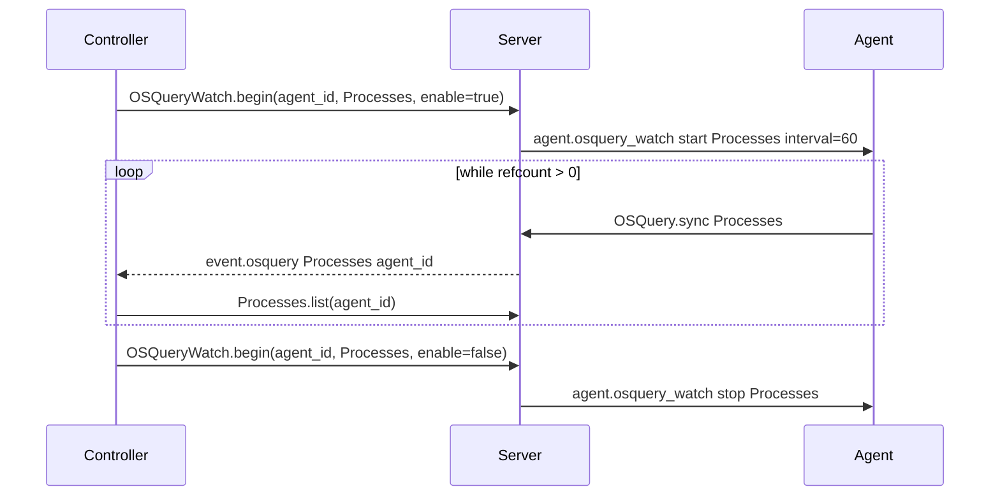

# Machine detail: processes and listening ports (view-driven live sync)

**Status:** ⏳ opened — design only; no implementation

**Pointer:** `docs/bug-fix-process.md`, `docs/rpc-commands.md`, [2026-11-14-machine-additional-osquery-data.md](2026-11-14-machine-additional-osquery-data.md), [2026-11-14-package-status-cache-notification.md](2026-11-14-package-status-cache-notification.md), [2026-11-14-log-monitoring-phases-2-3.md](2026-11-14-log-monitoring-phases-2-3.md), `docs/plans/1.1-implementation.md` (approved executables / sockets — later)

**Related:** [2026-11-14-machine-additional-osquery-data.md](2026-11-14-machine-additional-osquery-data.md) — `uptime` and agent connection on **General**; **Storage** tab (startup `mounts`).

---

## Problem

- 🔷 **Processes** and **listening ports** are high-cardinality osquery tables. A one-shot startup sync would bloat the DB and still go stale quickly.
- 🔷 **Expected:** while a controller is actively viewing a machine’s **Processes** or **Listening ports** tab, the agent refreshes that table on an interval (order of **~60 seconds**), pushes to the server, and the controller reloads from `*.list(agent_id)`. When nobody is watching, the agent **stops** polling.
- 🔷 **Actual:** no schema, no RPC, no agent poll loop, no machine tabs.

ℹ️ **Approved vs new** (baseline inventory, sign-off UI) is product/security work on top of the same snapshots — likely one shared tab pair and one watch RPC with two table names. Defer comparison logic until live sync exists.

---

## Evidence

- 🚫 `processes` and `listening_ports` are not in `agent/OSQuery/Execute.vala` `send_startup()` or server `init_db`.
- ✔️ Today’s live-ish tables (`logged_in_users`, packages) use **agent-initiated** `OSQuery.sync` after local events or timers — there is **no** path for the **controller to ask the agent** to turn collection on or off ([2026-11-14-log-monitoring-phases-2-3.md](2026-11-14-log-monitoring-phases-2-3.md) phase 3 notes a subscription surface).
- ✔️ Server → agent notifications today: `agent.run`, `agent.send`, `agent.removed` (`agent/Application.vala` `notification`). Controller → server uses RPC; server → agent uses `connection.write(OLLMrpc.Notification)` (same pattern as tasks in `server/Command.vala`).
- ✔️ Controller refresh after server data changes is planned generically as `event.osquery` in [2026-11-14-package-status-cache-notification.md](2026-11-14-package-status-cache-notification.md) — these tabs should subscribe when implemented.

---

## Proposed fix (design sketch — confirm before code)

### 1. Controller ↔ server: watch session (new RPC)

- 💩 Example shape (names TBD): `OSQueryWatch.begin(agent_id, table_name, enable)` where `table_name` is `"Processes"` or `"ListeningPorts"` (Argus class names, not raw osquery strings).
- 🔷 **Enable** when the user opens the tab (or switches to it with that machine selected). **Disable** when the tab is hidden, the machine selection changes, or the machine detail pane closes.
- 🔷 Server maintains a **reference count** (or set of controller connection ids) per `(agent_id, table_name)` so two controllers viewing the same machine do not flap the agent off when one leaves.
- 💩 Optional: **one-shot refresh** RPC (`OSQueryWatch.refresh`) for an immediate pull when the tab opens, before the first interval tick.

### 2. Server ↔ agent: notification

- 💩 New notification method, e.g. `agent.osquery_watch`, arguments: `action` (`"start"` / `"stop"`), `table_name`, optional `interval_seconds` (default ~60).
- 🔷 Server sends **start** when refcount goes from 0 → 1; **stop** when it goes 1 → 0. Agent is disconnected: RPC fails or queues; UI shows last snapshot + connection state (see inventory bug — `agent.connected` on General).

### 3. Agent: interval poll while watched

- 🔷 Agent holds active watches in memory (lost on restart — server re-sends start on next controller RPC after reconnect).
- 🔷 On each tick for an active watch: `osqueryi` select → existing `sync_table` / `OSQuery.sync` for that class.
- 🚫 Do **not** add processes/ports to `send_startup()`.
- 💩 Debounce: skip tick if previous sync still running; coalesce back-to-back starts.

### 4. Server → controller: data ready

- 🔷 After successful `OSQuery.sync`, broadcast `event.osquery` with `agent_id` + table name ([2026-11-14-package-status-cache-notification.md](2026-11-14-package-status-cache-notification.md)).
- 🔷 Processes / Listening ports tabs listen only while visible and matching `current_agent_id` (avoid reloading hidden tabs).

### 5. UI

- 🔷 Two machine detail tabs (order TBD): **Processes**, **Listening ports** — `Tab.Base` + column CSVs; filters and column visibility like Users/Interfaces.
- 🔷 Tab shows **Refreshing…** / relative “last updated” from row `updated_dt` or sync time.
- 🔷 Agent offline: show cached rows if any; label data as stale; disable watch RPC or no-op with clear empty state.

### 6. Schema & startup inventory

- 💩 Add `shared/OSQuery/Processes.vala`, `ListeningPorts.vala`, `init_db`, `list(agent_id)`, column subset (not every osquery column on v1).
- 🔷 Document RPC + notifications in `docs/rpc-commands.md` in the same change.
- 🔷 Update [4.0-data-types.md](../plans/4.0-data-types.md) when columns are chosen.

---

## Flow (reference)

---

## Next

- ⏳ Confirm RPC + notification names and default interval (~60s).
- ⏳ Confirm refcount rules when controller disconnects without a polite stop (server timeout clearing watch?).
- ⏳ Pick v1 columns and whether processes and ports share one watch helper on the agent.
- ⏳ Major-change checkpoint: new RPC + agent notification method (per `docs/bug-fix-process.md`).

---

## LLM notes

- 🚫 Do not ship full-table startup sync for these tables.
- 🚫 Do not implement approved/baseline diff in the same change as watch RPC unless explicitly scoped.
- 🔷 Reuse `OSQuery.sync` / `sync_rows` — new work is watch lifecycle + UI tabs + notifications.