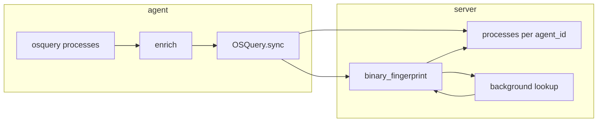

# Running processes: osquery sync and executable enrichment

**Status:** ⏳ opened — design only; no implementation

**Pointer:** `docs/bug-fix-process.md`, `docs/rpc-commands.md`, [2026-11-14-machine-processes-ports-live.md](2026-11-14-machine-processes-ports-live.md), `agent/linux/Apt/PackageExeValidator.vala`, `docs/plans/5.10-data-enrichment.md`

**Related:** [2026-11-14-machine-processes-ports-live.md](2026-11-14-machine-processes-ports-live.md) — view-driven poll and UI; this bug is the **agent query class**, **enrichment**, and **server-side Windows checksum trust**. Watch RPC and tabs can land after or in parallel once Phase 1 sync works.

---

## Problem

- 🔷 **Expected:** While a controller watches a machine (see related bug), the agent runs osquery **`processes`**, enriches each row with executable trust metadata, and posts via **`OSQuery.sync`**. On **Debian APT**, enrichment uses dpkg file lists and **`md5sums`** (existing **`PackageExeValidator`**). On **Windows**, the agent computes **SHA256**; the **server** matches hashes against a growing corpus and a **background** job gradually looks up unknown binaries online.
- 🔷 **Actual:** No **`shared/OSQuery/Processes`**, no agent **`Processes.send()`**, no enrichment wiring, no server fingerprint store, no checksum lookup worker. **`PackageExeValidator`** exists but is unused outside the agent tree.

ℹ️ **Approved vs new executables** (baseline, sign-off UI) stays later — [2026-11-14-machine-processes-ports-live.md](2026-11-14-machine-processes-ports-live.md), `docs/plans/1.1-implementation.md`. This bug delivers **facts** (package ownership, hash, verify status) the UI can use later.

---

## Evidence

- 🚫 **`processes`** is not in **`agent/OSQuery/Execute.vala`** **`send_startup()`** or server **`init_db`** (by design for high cardinality — [2026-11-14-machine-processes-ports-live.md](2026-11-14-machine-processes-ports-live.md)).
- ✔️ **`Execute.select()`** deserializes JSON into **`Argus.Shared.OSQuery.Row`** properties ([`agent/OSQuery/Execute.vala`](../../agent/OSQuery/Execute.vala)).
- ✔️ **`Package.send()`** is **`SELECT *`** only — processes need a custom **`send()`** with **`snapshot_sql()`** and **`enrich()`** ([`agent/OSQuery/Package.vala`](../../agent/OSQuery/Package.vala)).
- ✔️ **`PackageExeValidator`** maintains an in-memory dpkg index and per-path result cache ([`agent/linux/Apt/PackageExeValidator.vala`](../../agent/linux/Apt/PackageExeValidator.vala)); **`ExeVerifyStatus`** covers verified, unpackaged, hash mismatch, deleted binary, etc.

---

## Architecture

### Two layers

- 🔷 **Agent — collection and local truth**
  - **Debian APT:** “Local database” is **`PackageExeValidator`** (rebuilds when **`/var/lib/dpkg/status`** or **`info`** changes). No agent SQLite unless profiling proves poll cost needs persistence across restarts.
  - **Windows:** SHA256 of **`path`** when readable; **SQLite** (or equivalent) keyed by **`(path, mtime, size) → sha256`** so ~60s polls do not re-read every binary.
  - **RPM / UNKNOWN:** v1 sends osquery columns only; no package verify columns until an RPM analogue exists.
- 🔷 **Server — fleet-wide trust**
  - Global **`binary_fingerprint`** (or similar): **`sha256`** primary key, lookup status, metadata, source, **`checked_dt`**.
  - Process rows store **agent facts**; **`trust_status`** (or equivalent) is **server-derived** from fingerprints plus Linux **`exe_verify_status`** rules.
  - New hashes from sync → **`pending`**; a **rate-limited worker** resolves them against an online corpus (Winbindex, NSRL, or one v1 source).

### Sync model

- 🚫 Do **not** add **`processes`** to **`send_startup()`**.
- 🔷 Poll only while watched ([2026-11-14-machine-processes-ports-live.md](2026-11-14-machine-processes-ports-live.md)).
- 🔷 **`sync_rows`** key: **`{ "pid" }`** (live snapshot; rows missing from a snapshot get **`deleted_dt`** like other tables).

---

## Proposed fix (design — confirm before code)

### Contracts (confirm in Phase 0)

- 💩 **v1 osquery columns (TBD):** e.g. **`pid`**, **`name`**, **`path`**, **`cmdline`**, **`uid`**, **`parent`**, **`start_time`** — explicit list in **`snapshot_sql()`**, not **`SELECT *`**.
- 💩 **Enrichment columns on stored `processes` rows:**

| Column | Linux APT | Windows |
|--------|-----------|---------|
| `exe_verify_status` | **`ExeVerifyStatus`** as int | 0 / N/A in v1 |
| `package_name` / `package_version` | from validator | empty |
| `expected_md5` / `actual_md5` | when md5sums exist | empty |
| `sha256` | from **`ExeVerifyResult`** | from agent hash |
| `trust_status` | v1 may mirror verify status; later server rules | server from **`binary_fingerprint`** |

- 🔷 Unlike **`update_available`** in [5.10-data-enrichment.md](../plans/5.10-data-enrichment.md), enrichment fields **are** sent on **`OSQuery.sync`** and participate in **`sync_rows`** / **`compare`**.

---

### Phase 1 — Agent query class (implement first)

**Goal:** **`Processes.send()`** runs osquery and posts rows; **`enrich()`** is a no-op stub.

1. **`shared/OSQuery/Processes.vala`**
   - **`init_db`**, **`rpc_register`**, **`Processes.list(agent_id)`**
   - Properties for osquery plus enrichment (defaults empty / 0)
   - **`sync()`** → **`sync_rows<Processes>(…, "processes", { "pid" })`**
   - **`snapshot_sql()`** — fixed column list

2. **`agent/OSQuery/Processes.vala`**
   - Does **not** implement **`Package`**
   - **`send(Application)`:** **`Execute.init()`**; **`select`** with **`snapshot_sql()`**; **`enrich(fresh)`** (empty); **`OSQuery.sync`** with class **`Processes`**
   - Wire into **watch tick** when watch RPC exists; until then, manual / dev test of sync

3. **Server:** register **`init_db`**, **`OSQuery.sync`** dispatch (same pattern as **`LoggedInUsers`**)

4. **`docs/rpc-commands.md`** — **`Processes.list`** in the same change as schema

**Out of scope Phase 1:** watch RPC, controller tab, enrichment, fingerprint worker

---

### Phase 2 — Debian APT enrichment

- 🔷 Lazy **`PackageExeValidator`** on **`Application`** (or local in **`Processes.send()`**)
- 🔷 For each row with non-empty **`path`**: **`verify_exe(path)`** → map **`ExeVerifyResult`** to row properties
- 🔷 Skip paths that fail fast (empty, deleted suffix handled by validator)
- ⏳ Profile before adding agent SQLite

---

### Phase 3 — Windows SHA256 + agent cache

- 🔷 **`agent/Win32/ExeChecksumCache.vala`** (name TBD): SQLite under agent data dir
- 🔷 **`enrich`:** cache hit by path + mtime + size; else hash (same SHA256 approach as **`PackageExeValidator.compute_file_hashes`**)
- 🔷 Bound work per poll (max N new hashes per tick) so sync does not stall on large binaries

---

### Phase 4 — Server fingerprint store

- 🔷 Table **`binary_fingerprint`**: **`sha256`**, **`lookup_status`** (`pending` / `known` / `unknown` / `error`), **`source`**, product/publisher fields, **`checked_dt`**, optional **`seen_count`**
- 🔷 On **`Processes.sync`**: **`INSERT OR IGNORE`** pending fingerprints for new **`sha256`** values; bump seen count
- 🔷 Derive **`trust_status`** on process rows (sync hook or **`list`** join): Linux **`HASH_MISMATCH`** etc. wins over passive “known” Windows hash

---

### Phase 5 — Gradual online lookup (server)

- 🔷 Timer or cron: dequeue **`pending`** by **`seen_count`** DESC, rate limit
- 🔷 v1 adapter: one external source (Winbindex or NSRL — pick before implementation)
- 🔷 Success → **`known`** + metadata; not found → **`unknown`** with backoff
- 🚫 Major-change checkpoint: outbound network, API keys, retention — approve before production

---

### Phase 6 — UI and watch lifecycle

- 🔷 Implement [2026-11-14-machine-processes-ports-live.md](2026-11-14-machine-processes-ports-live.md): **`OSQueryWatch`**, **`agent.osquery_watch`**, machine **Processes** tab, column CSV
- 🔷 Show **`exe_verify_status`**, **`sha256`**, **`trust_status`** in grid

---

## Suggested order

1. Confirm Phase 0 column list and **`snapshot_sql()`**
2. Phase 1 — shared + agent **`Processes`** + server **`init_db`**
3. Phase 2 — **`PackageExeValidator`** wiring
4. Phase 3 — Windows cache + hash
5. Phases 4–5 — server trust pipeline
6. Phase 6 — UI + watch (can overlap Phase 2 after Phase 1 sync works)

---

## Open questions

- ⏳ Watch RPC before or after Phase 1? (Class can ship with manual sync for dev.)
- ⏳ Exact v1 osquery column set
- ⏳ Windows lookup source for v1 (Winbindex vs NSRL)
- ⏳ Whether **`trust_status`** is server-only on the wire (agent sends Linux verify + **`sha256`** only)

---

## Next

- ⏳ User confirms contracts and **`docs/bugs/2026-11-21-processes-exe-enrichment.md`** as the implementation pointer
- ⏳ Implement Phase 1 after confirmation

---

## LLM notes

- 🚫 Do not put processes in **`send_startup()`**
- 🚫 Do not use **`Package.send()`** / **`SELECT *`** for processes
- 🚫 Do not implement approved/baseline diff in the same change as Phase 1 unless explicitly scoped
- 🔷 Reuse **`OSQuery.sync`** / **`sync_rows`**; new work is **`Processes`**, enrichment, fingerprints, watch + UI
- 🔷 Record RPC changes in **`docs/rpc-commands.md`**